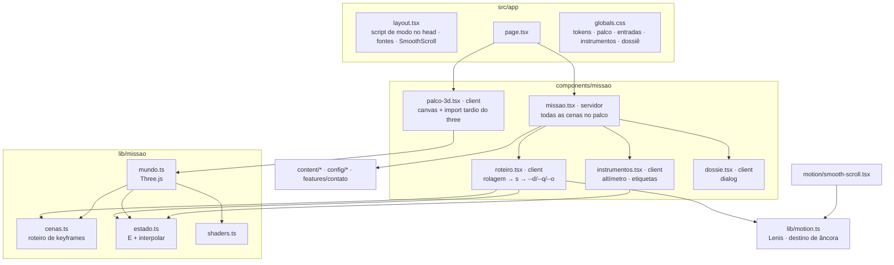

# Mapa do código — DETERA

> Gerado pelo Cartographer em 01/11/2026 e revisto à mão em 07/11/2026, no enxugamento da v3. Contagem de tokens estimada.

Site institucional de página única da DETERA. Next.js 16 (App Router + Turbopack), React 19, TypeScript estrito, Tailwind CSS v4, Three.js, Lenis e GSAP (só o `ticker`), tudo pelo npm (a CSP bloqueia CDN). Pré-renderizado estático; sem backend. O formulário de contato monta a mensagem e abre o WhatsApp.

A v3 transforma a página numa **missão espacial curta dirigida pela rolagem**: a apresentação na Via Láctea, um zoom contínuo até o sistema solar, um planeta por projeto, o que a DETERA faz, o planeta de quem está lendo e a reentrada até o contato. Plano em [design-plan.md](design-plan.md).

## Visão geral



## Estrutura de diretórios

```
src/
├── app/                  layout (script de modo no <head>), page, globals.css, erros, icon, OG, robots, sitemap
├── components/
│   ├── brand/            marca-paths.ts (geometria única) e wordmark.tsx (Simbolo, Letreiro com letras que caem)
│   ├── layout/           header (client, menu em <dialog>) e footer
│   ├── missao/           missao (servidor), palco-3d, roteiro, instrumentos, dossie (client)
│   ├── motion/           smooth-scroll (Lenis + âncoras)
│   ├── secoes/           contato, depois da missão
│   └── ui/               button, container, icones (pixel)
├── config/               site.ts, nav.ts
├── content/              todo o texto
├── features/contato/     formulário + schema zod
└── lib/
    ├── missao/           cenas, estado, mundo (Three.js), shaders
    ├── motion.ts         Lenis compartilhado e resolvedor de âncora
    ├── seo/json-ld.tsx
    └── utils/            aleatorio (PRNG com semente), cn, env, whatsapp
public/fonts/             Oxanium (variável) e Spectral (300, 400, 300 itálico)
docs/                     este mapa, design-plan.md, identidade/ (manual da marca da v2, desatualizado)
```

## Módulos

### Roteiro (`lib/missao/cenas.ts`)
`ROTEIRO` é uma lista de cenas parciais: cada linha diz só o que muda. `montarCenas` acumula sobre `PADRAO`; `rastro`, `rotulos`, `nuvens`, `viagem`, `hold` e `painel` não passam adiante (`NAO_HERDA`). Campos: `foco` (sistema, núcleo ou planeta 0–4), `dist/az/el`, `ox/oy`, `galaxia`, `atmos`, `ceu`, `plasma`, `tremor`, `relevo`, `nuvens`, `alt`, `rotulos`, `rastro`, `lado`, `entrada`, `painel`, `hold` e `viagem` (svh). `medidas()` dá o início de cada cena e a altura total.

Cenas, em ordem: `topo` (Via Láctea; viagem longa de 190 svh), `projetos` (o sistema), `projeto-sencis`, `projeto-fidele`, `projeto-yasmin`, `projeto-keepnew`, `solucoes` (perto do núcleo), `seu-projeto` (planeta azul), `reentrada`, `sinal` (crepúsculo).

### Estado (`lib/missao/estado.ts`)
`E` é um objeto mutável fora do React (lido a cada quadro). `interpolar(s)` escreve as cenas vizinhas `a`, `b`, a mistura `t` (smootherstep) e os canais numéricos; o altímetro segura a última leitura; `rastro = max(B.rastro·sin(π·frac), plasma·0,9)`; `nuvens = B.nuvens·sin(π·frac)`.

### Rolagem → cena (`components/missao/roteiro.tsx`)
`.missao` tem `height: calc(var(--total) * 1svh)` e o `.palco` é `sticky` de 100svh com todos os cartões absolutos. A cada tique do `gsap.ticker`: posição local em svh → `s` (inteiro durante a parada, fracionário na viagem) → `interpolar(s)` → para os cartões com `|s - i| < 1`, `--d` (-1..1), `--q` (gravidade: chega com `-1 + (1+d)²`, sai com `d²`) e `--o` (assimétrica: o que sai some cedo, o que chega aparece tarde). Também escreve `--plasma` no `html` (escurece o cabeçalho) e o tremor no `transform` do palco. Expõe `window.__missao` para os scripts de QA.

### Entradas dos cartões (CSS)
Só em `html.js:not(.linear)`. `lateral`: `translateX(d · -36vw)` (−70vw no celular); `queda`: `translateY(q · 72svh)`. Cenas com `painel` e todos os cartões no celular ganham fundo sólido.

### Mundo 3D (`lib/missao/mundo.ts`, `shaders.ts`)
**Duas cenas**, porque as escalas não cabem no mesmo espaço:
- **Via Láctea** (`galaxia`, com `galaxiaCam` própria): `Points` com tamanho em unidades do mundo (o zoom é de verdade), em três camadas: nuvens de luz, poeira escura e estrelas, em espiral logarítmica com barra central, mais um sprite no miolo e o Sol vermelho no braço. A distância cai em escala logarítmica de 205 a 0,5 enquanto o olhar sai do centro para o Sol. No fim, Sol e núcleo do sistema coincidem no centro da tela.
- **Sistema solar** (`cena`): núcleo, 5 planetas com shader procedural (`PLANETAS`: Sencis, FIDÈLE com anel, Yasmin, Keep New, o azul), halos, órbitas, cinturão em `InstancedMesh`, estrelas e céu (os dois com `uAlfa`, entram no fim do zoom). A câmera mistura ao vivo as poses das duas cenas vizinhas, sobe em arco na viagem, cede ao cursor com mola, treme na reentrada e usa `setViewOffset` (em retrato o objeto sobe).

A camada `tela` (quad de tela cheia, blending pré-multiplicado) desenha por cima: céu da descida e do crepúsculo, nuvens, relevo, plasma nas bordas (substitui a cor), rastros e o rastro radial da travessia. `quadro` escreve `E.projecoes` para as etiquetas.

### Instrumentos (`components/missao/instrumentos.tsx`)
Altímetro (aparece com `alt`) e etiquetas dos planetas presas por linha SVG à posição projetada. A lista `ROTULOS` segue a ordem de `PLANETAS` em `mundo.ts`. Escrita direta no DOM, sem React.

### Conteúdo da missão (`components/missao/missao.tsx`)
Servidor. Cada cena é `div.cena#<id>[data-cena][data-lado][data-entrada][data-ato]` com `.cartao`. O conteúdo é escolhido pelo `id` da cena (renomear um id em `cenas.ts` esvazia a cena sem erro). A cena 0 sai do servidor visível. Conteúdo longo vai num `Dossie`: caso inteiro com as notas medidas, entregas, como funciona, quem faz; as perguntas frequentes ficam em `secoes/contato.tsx`.

### Âncoras e foco
O id da cena está num elemento absoluto dentro do palco, então o navegador não sabe rolar até ele. `roteiro.tsx` registra em `lib/motion.ts` um resolvedor (`definirDestino`) que devolve o começo da parada da cena; `smooth-scroll.tsx` usa esse ponto no `lenis.scrollTo`. Endereço aberto com `#projetos` é levado à cena no primeiro quadro; Tab que entra num cartão fora de cena rola até ele.

### Modo linear
Decidido por script no `<head>` antes da pintura: movimento reduzido, altura ≤ 520 px ou sem WebGL (`html.linear`, e `sem-webgl` esconde o canvas). Também entra se o `Mundo` falhar ao criar. As regras de cinema somem; os cartões viram blocos empilhados sobre fundo escuro; a câmera fica parada na Via Láctea. O modo não muda depois de carregar.

## Desempenho
- `three` importado sob demanda depois da primeira pintura.
- Modo leve (toque ou ≤ 4 núcleos): DPR 1, menos oitavas de fbm, menos pontos na galáxia (22 mil contra 60 mil), menos estrelas e rochas, sem antialias.
- DPR máximo 1,5; `aliviar()` cai para 1 se os 120 primeiros quadros passarem de 28 ms em média.
- Cada cena só é desenhada quando aparece: a galáxia some depois do zoom, o sistema não é desenhado de longe nem sob a atmosfera, a camada `tela` só com algum efeito ativo, e nada roda com a aba oculta.

## Segurança e infraestrutura
`next.config.ts` exporta função da fase do Next. CSP: `script-src 'self' 'unsafe-inline'` (o script de modo e o recado do console são inline), `font-src 'self'`, `img-src 'self' data: https://yasmin-g-studio.vercel.app`, `frame-src https://keepnew.vercel.app`, `connect-src 'self'`, `object-src`/`frame-ancestors 'none'`. HSTS sem `preload`. Redirects 307 das URLs antigas para âncoras.

| Variável | Sem ela |
|---|---|
| `NEXT_PUBLIC_SITE_URL` | `noindex` e `disallow: /` (preview não é indexado) |
| `NEXT_PUBLIC_WHATSAPP_NUMBER` | número fixo no código |
| `VERCEL_PROJECT_PRODUCTION_URL` | `http://localhost:3000` |

Publicação: push em `main` de `SamuelcCouto/detera-premium` → Vercel (detera-premium-ten.vercel.app). Projeto separado do site oficial.

## Convenções
- Português em identificadores, conteúdo e comentários; o comentário explica a alternativa rejeitada.
- Nada de `Math.random()` no servidor: estrelas e rochas usam `criarGerador` com semente.
- Movimento por `data-*` e variáveis CSS; o que é por quadro passa por `E` e escrita direta no DOM, nunca por estado do React.
- Número só se for medido: as notas do PageSpeed têm data e link do relatório.

## Armadilhas
1. **Oxanium e Spectral por `@font-face`**, não por `next/font` (Turbopack não resolve a Oxanium aqui; CSP só aceita fonte própria).
2. **"DETERA" com A latino (U+0041).**
3. **Uma função só escreve o estado da cena** (`interpolar`). Não crie tween que escreva em `E` por fora.
4. **Plasma substitui a cor, não soma**: somado sobre o azul ele estourava para rosa-creme.
5. **Curva de opacidade assimétrica**: igual para os dois cartões, eles se cruzavam no meio da viagem.
6. **Lenis já desconta `scroll-padding-top`**: não passe `offset`. Nada de `scroll-behavior: smooth`.
7. **Dossiê e menu param o Lenis** e o corpo do dossiê tem `data-lenis-prevent`. Nunca ponha `data-lenis-prevent` no conteúdo das cenas.
8. **A ordem de `PLANETAS` (`mundo.ts`), `ROTULOS` (`instrumentos.tsx`) e `foco` das cenas anda junto.** Projeto novo mexe nos três, mais o conteúdo em `missao.tsx`.
8b. **Cartões no celular** têm altura máxima e rolam por dentro em tela muito curta; o conteúdo longo vai para o dossiê, não para o cartão.
9. **QA em headless**: WebGL por software (`--use-angle=swiftshader`); a auditoria da skill `mobile` derruba o Chromium em 1920×1080 nesta página — rode com `--sizes` sem o maior. O preview oculto do app não roda `requestAnimationFrame`.
10. **Imagem externa e iframe exigem CSP** (`img-src`, `frame-src`).

## Guia de navegação
- **Mudar texto** → `src/content/*.ts` (frentes, processo, casos, perguntas) ou `missao.tsx` (frases das cenas e dos dossiês).
- **Mudar a coreografia** (câmera, atmosfera, tempo de parada, lado do cartão, tipo de entrada) → `src/lib/missao/cenas.ts`.
- **Nova cena** → linha em `ROTEIRO` + conteúdo no mapa `conteudo` de `missao.tsx` com o mesmo id.
- **Novo projeto (planeta)** → `PLANETAS` em `mundo.ts`, `ROTULOS` em `instrumentos.tsx`, uma cena em `cenas.ts` e o conteúdo em `missao.tsx`.
- **A galáxia** → `montarGalaxia` e o trecho "A Via Láctea" de `quadro`, em `mundo.ts`.
- **Visual dos planetas, céu, plasma, nuvens, relevo** → `src/lib/missao/shaders.ts` (cores dos planetas em `PLANETAS`, `mundo.ts`).
- **Instrumentos** → `instrumentos.tsx` + bloco "Instrumentos" do CSS.
- **Cores e fontes** → `@theme` em `globals.css` (medir contraste antes).
- **Formulário** → `src/features/contato/`.
- **SEO** → `metadata` em `layout.tsx`, `lib/seo/json-ld.tsx`.
